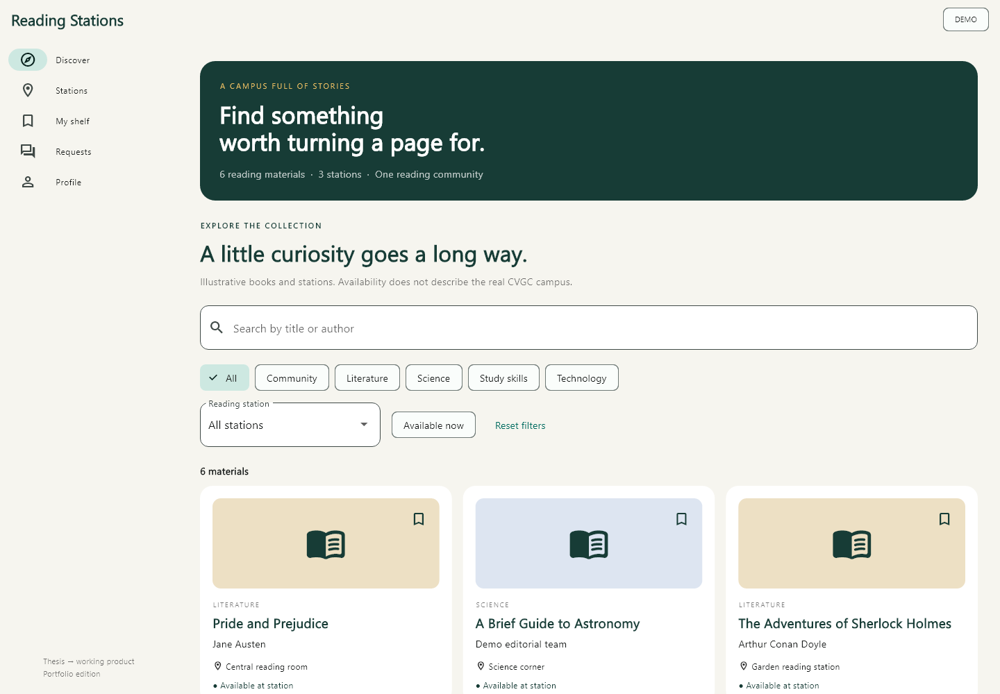

# Reading Stations Explorer

A campus reading catalogue rebuilt from a bachelor thesis for Comilla Victoria Government College (CVGC). Discover materials before visiting a reading station, save a personal reading shelf, and help administrators maintain the collection.

**Status:** portfolio rebuild. One Flutter application targets Android and web. Default mode is a working local demo with fictional data. Firebase mode is implemented separately and requires your own Firebase project, deployed rules, and integration validation. This is not an official college service.



[Mobile preview](docs/previews/catalogue-mobile.png) · [Welcome screen](docs/previews/welcome-desktop.png)

## What you can explore

- Search titles and authors; filter by category, station, and availability.
- Browse reading stations and find their materials.
- Save favourites and inspect material details.
- Suggest materials and report missing items; track request status.
- In administration, add/edit/remove materials and stations, process requests, and copy a catalogue report.
- Use a responsive layout with desktop navigation and mobile navigation.

The public demo is reader-only. It stores favourites and requests on the current device; catalogue administration is unavailable. Firebase mode uses email/password authentication, private user profiles, and server-enforced administrator claims. Passwords and Firebase session tokens are not saved to local preferences.

## Run locally

See [validation](docs/VALIDATION.md) for the exact checks completed on this package. The initial build baseline is **Flutter 3.10.4 / Dart 3.0.3**, matching the available SDK. This is an older baseline; upgrading to a supported Flutter release is an explicit next milestone, not an implied compatibility claim.

```sh
flutter pub get
flutter run -d chrome
# Or select an Android device listed by flutter devices:
flutter run -d DEVICE_ID
```

Choose **Explore as a reader**. No credentials are needed in demo mode. Profile → Reset demo data restores the sample catalogue.

```sh
flutter analyze
flutter test
flutter build web --release
flutter build apk --debug
```

## Project map

```text
lib/src/app.dart           Responsive screens and forms
lib/src/store.dart         Application state and persistence
lib/src/models.dart        Catalogue, stations, requests, fictional seeds
lib/src/firebase_api.dart  Firebase Auth and Firestore REST adapter
test/                     Behaviour and UI regression checks
firestore.rules           Access control and document validation
docs/                     Setup, architecture, case study, roadmap, publication
archive/original-flutter/  Sanitized original Dart source for provenance
```

## Publish and connect your portfolio

Follow [GitHub and portfolio instructions](docs/PUBLISHING.md). A manual GitHub Actions workflow builds the demo for GitHub Pages; no Firebase credentials are needed. Keep production Firebase configuration out of the public demo.

- [Firebase setup](docs/FIREBASE.md)
- [Architecture and thesis mapping](docs/ARCHITECTURE.md)
- [Portfolio case study](docs/PORTFOLIO.md)
- [Incremental development roadmap](docs/ROADMAP.md)
- [Privacy and publication notes](SECURITY.md)
- [Third-party and academic material](NOTICE.md)

Original thesis files, student records, compiled old binaries, Firebase project configuration, and signing material are excluded. No open-source license has been assigned to academic or third-party material; see NOTICE before choosing a license.
