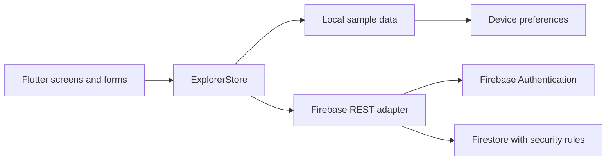

# Architecture and thesis mapping

The thesis sequence is preserved as a product journey: create/access an account → discover a material → find its station → save it → submit requests or missing-material reports → administer the collection.

The rebuild uses one Flutter UI for web and Android. Layout changes at 900 logical pixels: desktop uses a navigation rail, while narrower layouts use bottom navigation. Book cards change column count with available space.

| Thesis area | Rebuild implementation | Difference |
| --- | --- | --- |
| Account registration/login | Firebase email/password and profile | Demo uses explicit sample roles; no fake passwords |
| Search | Title/author search and category/station/availability filters | More discovery controls |
| Reading station exploration | Station list with location and linked materials | No GPS or maps are claimed |
| Favourite materials | Per-user shelf in Firebase; local shelf in demo | No public user directory |
| Material management | Administrator CRUD with validated forms | New document schema; old backend is not reused |
| Missing material/report | Owned requests and admin resolution | Three statuses: pending, resolved, declined |
| Report generation | Copyable catalogue summary | No analytics or audit-log system is claimed |
| Reading resource | Validated HTTPS external resource link | No PDF upload or embedded PDF reader |

## State and data

`ExplorerStore` handles operations, errors, loading state, and mode selection. Firebase mode is selected only when both compile-time configuration fields are set. It never falls back to demo data on a network failure. Firebase reads use an explicit refresh; real-time listeners are intentionally absent. Users can refresh the catalogue from the toolbar.

The Firebase adapter attaches the Firebase ID token to Firestore requests, refreshes expiring tokens, paginates catalogue queries, and queries requests by owner for readers. Firestore security rules enforce access independently of the UI.

| Collection | Document fields | Access |
| --- | --- | --- |
| stations | name, location | Signed-in read; admin write |
| books | title, author, category, stationId, description, url, available | Signed-in read; admin write |
| users | name, email, favourites | Owner only; no list access |
| requests | userId, title, author, type, status | Owner read/create; admin read/status update |

## Migration boundaries

The original app used different field names such as `bookName`, `stationID`, `metric`, and `bookRequests`. The new app requires a fresh Firebase database or an explicit reviewed migration; it does not mutate the original database. Archive code is not imported by the rebuild.

No material is written merely because it was read. Catalogue IDs come from document paths. Station deletion is blocked in the application when its loaded catalogue contains books. Firestore rules cannot enforce a collection-wide referential constraint; concurrent administrators must coordinate station deletion, or add a transactional trusted backend before a larger deployment.

The portfolio demo is a single fictional workspace. Demo role switching shares that local workspace and is not an authentication boundary. Live favourites are stored on the user's profile. Multiple concurrent sessions use last-write-wins profile updates; collaborative conflict handling is a future enhancement.
